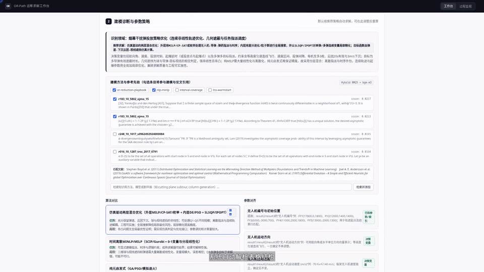
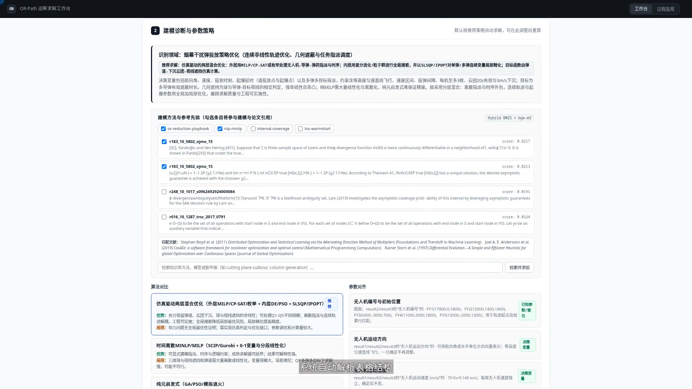
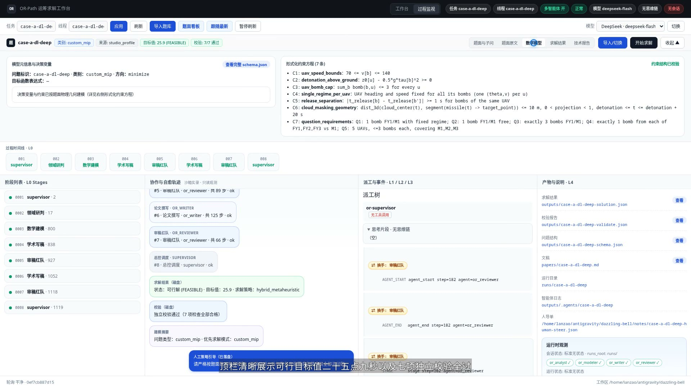
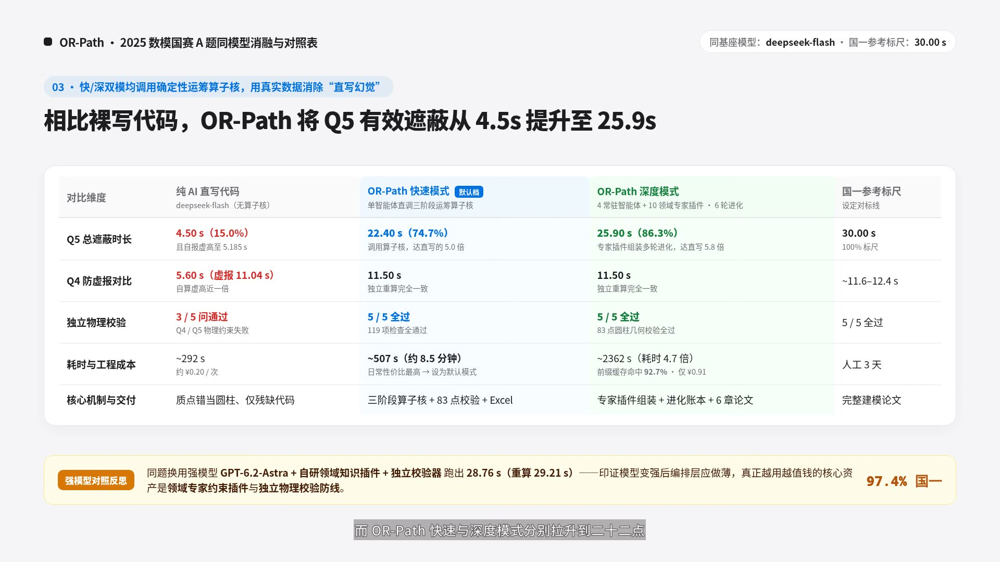

# OR-Path：防幻觉、可审计的运筹优化多智能体与决策工作台

**面向数学建模竞赛与复杂工业优化场景的确定性运筹智能体系统** —— 上传题面 PDF 与数据附件后，自动完成字段对齐与领域诊断，通过 **三阶段确定性运筹算子核** 配合 **独立物理重算校验防线**、**4 常驻隔离智能体 + 10 套领域专家插件（`DomainCartridge`）** 以及 **人机协同实时看板**，彻底消除大模型直写求解代码时的“数值虚报幻觉”与“最优性措辞幻觉”。

[]()
[]()
[]()
[-16a34a.svg)]()

---

## 🎬 完整产品与工程演示视频

点击下方动图可查看或下载 **`1080p` 完整有声演示视频**（04:48，完整演示 2025 数模国赛 A 题导入对齐、快/深双模切换、8 阶段状态流转、6 轮演化抽屉、7 项物理校验、6 章全屏论文审阅、人导断点介入以及 30 秒国一标尺消融对照表）：

[](https://github.com/lanzaoi/or-path/raw/main/docs/media/orpath-demo.mp4)

> 📺 **完整视频文件**：[`docs/media/orpath-demo.mp4`](./docs/media/orpath-demo.mp4)（`22 MB`，`1920×1080`，H.264/AAC）。

---

## 🎯 解决什么痛点？（防幻觉两条铁律）

裸大模型直接编写运筹优化代码通常会在上线或竞赛评审前栽在两类幻觉上：
1. **数值幻觉与自检造假**：漏掉关键物理约束导致目标值失真、自算指标虚高近一倍，写校验脚本时还会硬编码凑数或偷调求解器蒙混过关；
2. **最优性措辞幻觉**：启发式方法明明只求得可行解（`FEASIBLE`），报告里却顺嘴宣称“已取得全局最优解”。

为此，OR-Path 用确定性工程边界锁死流程：
- **求解与校验物理隔离**：独立校验器运行前必过 AST 静态扫描，**严禁导入任何求解器库**（`ortools` / `highspy` / `scipy.optimize` / `pulp`），必须读取原始输入题面与表格从头重算；未证明 `OPTIMAL` 时硬拦截“全局最优”字样。
- **人机协同“只改策略、不改数字”**：支持题面导入后的交互式字段确认，以及运行途中在实时看板暂停注入建模策略并断点续跑，但机制上严禁人工直接篡改解向量与目标数值。

---

## ⚙️ 核心架构：三阶段通用算子核 × 双模专家插件组装

| 能力维度 | 快速模式（Fast · **默认档**） | 深度模式（Deep · 3 / 5 / 8 轮演化） |
| :--- | :--- | :--- |
| **算子核调度** | **单智能体直接调用三阶段运筹算子核**（非裸大模型直写随机代码） | 共用三阶段算子核 + 双轨多轮演化账本（[`evolution_ledger.py`](./orpath/agents/evolution_ledger.py)） |
| **智能体与插件** | 主链路直达建模、求解与独立重算 | **4 常驻隔离智能体**（分析 / 建模 / 撰写 / 审稿红队）+ **10 套领域专家插件（`DomainCartridge`）动态组装** |
| **过程与交付** | Excel / JSON 解产物 + 全套独立物理校验 | 实时演化曲线抽屉 + 6 章结构化论文全稿 + 对立红队审稿 |
| **适用场景** | 日常作业、时间受限场景（性价比最高） | 复杂多阶段竞赛难题、高价值工业排产与论文全案交付 |

### 代码级防线与工程底座
- **三阶段可复用算子核（[`tools/or_kernels/`](./tools/or_kernels/)）**：`物理几何离散提取 → 通用运筹规约（HiGHS / OR-Tools）→ 连续局部抛光`，统一调度 24 类求解模块。
- **三道硬隔离门禁**：AST 静态禁导求解库 + 沙箱读写权限门禁与硬编码伪造拦截 + 5 类数据篡改注入测试（检验校验器真能抓假）+ 最优性措辞审计。
- **LangGraph 16 节点文件指针流水线（[`orpath/graph_product.py`](./orpath/graph_product.py)）**：大体积解向量与表格全量落盘，状态仅传文件指针防上下文溢出；基于 SQLite 持久化支持断点续跑；历史经验先剥离具体坐标与数值后再回灌本地混合知识库（BM25 + FTS5 + BGE-M3 + RRF），杜绝跨题串数。

---

## 🖼️ 系统界面与对照实验截图

| Web Studio 题面诊断与 10 列字段对齐 | Live Watch 过程监视与 8 阶段收敛轨迹 | 2025 数模国赛 A 题对照实验总表 |
| :---: | :---: | :---: |
|  |  |  |

---

## 📊 2025 数模国赛 A 题消融与强模型对照（国一标尺：`30.00 s`）

| 对比维度 | 纯 AI 直写代码<br>(`deepseek-flash`) | OR-Path 快速模式 **（默认档）**<br>(`deepseek-flash`，调算子核) | OR-Path 深度模式<br>(`deepseek-flash`，6 轮进化) | 强模型对照<br>(`GPT-6.2-Astra` + 自研领域插件) | 国一高分参考标尺 |
| :--- | :---: | :---: | :---: | :---: | :---: |
| **Q5 总遮蔽时长** | `4.50 s`（`15.0%`，自报虚高 `5.185 s`） | **`22.40 s`（`74.7%`）** | **`25.90 s`（`86.3%`）** | **`28.76 s`（重算 `29.21 s`，`97.4%`）** | `30.00 s`（100%） |
| **Q4 防虚报对比** | `5.60 s`（虚报 `11.04 s`） | `11.50 s`（重算一致） | `11.50 s`（重算一致） | `11.66 s`（重算 `11.72 s`） | ~`11.6–12.4 s` |
| **独立物理校验** | `3 / 5` 问通过 | **`5 / 5` 全过**（119 项检查） | **`5 / 5` 全过**（83 点圆柱校验） | **`5 / 5` 全过** | `5 / 5` 全过 |
| **耗时与工程成本** | `~292 s`（约 `¥0.20`） | **`~507 s`**（约 8.5 分钟） | `~2362 s`（缓存命中 **`92.7%`** · **`¥0.91`**） | `~733 s` | 人工 3 天 |
| **核心启示** | 裸写易把圆柱简化为质点 | 调三阶段算子核把结果拉升 **5.0 倍**，日常性价比最高 | 专家插件组装 + 多轮进化逼近国一 | **证明模型变强后编排应做薄，真正沉淀下来有长期壁垒的是领域约束插件与独立物理校验** | — |

### 跨赛事与国际标准算例验证
- **全国大学生数学建模竞赛**：2025 A 题（无人机烟幕干扰弹连续遮蔽优化）、2026 C 题（园区微电网 334 天 × 144 时段 = 48,096 区间 MILP 调度，24 项物理校验全过）。
- **全国运筹学工业优化大赛（工业工程优化大赛）**：空间异形圆管三维展开与四模式共线激光下料（跨批次余料结转与物理几何重算校验全过）。
- **标准运筹基准集**：TSPLIB 8 例全部求得可行解（5 例达精确最优，最大 Gap `1.41%`）；支持 JSSP（67 例）/ FJSSP（407 例）工业调度基准与多联骨牌精确覆盖（CP-SAT）。

---

## 🚀 快速开始与工程测试

```bash
# 1. 安装依赖并运行环境诊断
pip install -r requirements.txt
python scripts/orpath_doctor.py

# 2. 启动 Web Studio 工作台与 Live Watch 过程看板（http://127.0.0.1:8765）
./START.sh        # Windows 双击 START.bat

# 3. 运行核心单元测试（已实测 tools/ 下 722 passed, 3 skipped）
pytest tools/ -q -p no:langsmith
```

### 目录导航

| 路径 | 说明 |
| :--- | :--- |
| [`orpath/`](./orpath/) | 控制面、LangGraph 16 节点工作流、Web Studio / Live Watch 前端源码与聚合引擎 |
| [`orpath/agents/`](./orpath/agents/) | 4 常驻智能体、10 套领域专家插件（`cartridges.py`）与双轨演化账本 |
| [`tools/or_kernels/`](./tools/or_kernels/) | 三阶段通用运筹算子核（物理提取、MILP 规约、连续遮蔽/LNS 局部抛光） |
| [`tools/validate_solution.py`](./tools/validate_solution.py) | 独立物理重算校验总入口与 [`tools/validators/`](./tools/validators/) 各域校验器 |
| [`knowledge/skills/`](./knowledge/skills/) & [`knowledge_svc/`](./knowledge_svc/) | 领域专家 Skill 知识包与本地混合检索底座（BM25 + FTS5 + BGE-M3） |
| [`docs/media/`](./docs/media/) | 演示视频（`.mp4`）、预览动图（`.gif`）与核心功能/对照实验截图 |
