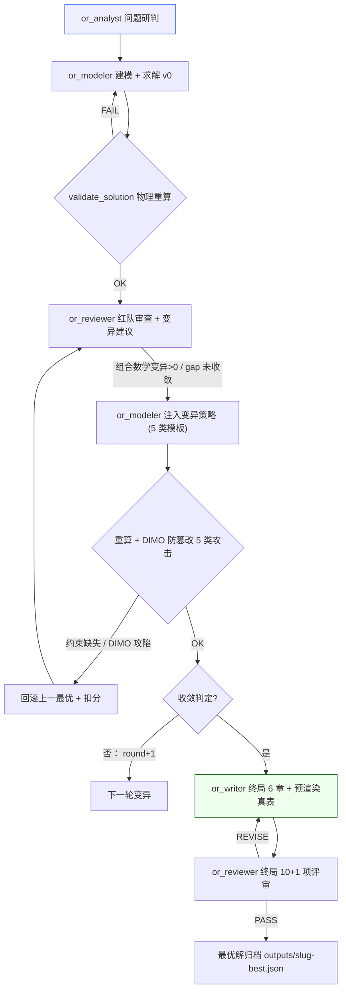
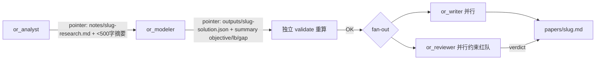

# OR-Path 快速模式极致提速与深度迭代方案

> 范围：在**完整保留 4 核心智能体流水线**（`or_analyst → or_modeler → or_writer → or_reviewer`）的前提下，逐行审查 `orpath/agents/supervisor.py`、`orpath/agents/workers.py`、`orpath/agents/tools_or.py`（题面口误，实际位于 `orpath/agents/tools_or.py`）、`tools/solve_dispatch.py`、`tools/validate_solution.py`、`orpath/agents/dimo_mutator.py`、`orpath/pipeline/*.py`，目标是把 12~14 分钟的拖沓执行压缩到 1~2 分钟极速收敛，同时给出深度迭代模式的高胜率闭环方案。
>
> 证据口径：本机 `.venv` 实测标定（文档《系统执行加速与极致减负调研报告》附录 A）：确定性离线 14 阶段链路墙钟 **2.54s**；LLM 短调用（无工具）**3.0~3.4s**；LLM 长文生成（完整论文）实测触发 `429 request frequency limit exceeded`，重放挂起 **>300s** 超时；`python` 冷启（scipy/numpy/networkx 三进程）**0.39s**、`pyvrp` **0.18s**、`pyjobshop` **0.56s**；门禁脚本 warm **0.04~0.14s**。
>
> **核心约束（不可违背）**：① 编制绝不砍——4 个 LLM 智能体的认知/建模/撰写/审查职责全部保留；② 提速不是阉割——所有加速都只削减“无效等待、无脑重试、上下文膨胀与冷启重复计算”，不改变 Numbers Truth 的物理重算铁律。

---

## 第〇部分：基线事实——钱花在哪了

| 时间池 | 实测占比 | 来源字符（file:line） |
|---|---|---|
| LLM 单次对话往返（短） | ~3~10s/次 | `orpath_with_tools watch` 中 `app_ma.invoke`（`scripts/orpath_watch.py:1680`） |
| LLM 长文论文/评审生成（被端点限流） | 单次最坏 >300s 挂起 | `orpath/paper_workflow.py:794` / `:880` |
| 4 智能体上下文重放滚雪球 | 输入 6~7 万 tokens，外部端点 TTFT 恶化 | `orpath/agents/supervisor.py:594-675`（`create_supervisor` + MessagesState） |
| 工具直抛错误 → LLM 重新试错 | 15 次失败 ≈ 75~225s | `orpath/agents/workers.py:124-167` 旧版 `read_problem_file` |
| 求解器/沙箱/验证子进程冷启 | 每次 0.39~0.6s 起，叠加重试 ×N | `tools/solve_dispatch.py:113-142`、`orpath/agents/tools_or.py:376/486` |
| 验证门/网格门重复子进程 | 1~3s（warm 累加） | `orpath/gates.py:28-80`、`orpath/pipeline/paper.py:315-460` |
| 确定性算力（真正算解） | 仅 **2.54s（<1%）** | 14-stage 切片实测 |

**结论**：12~14 分钟里 ~99% 是 LLM 调用 + 参数性浪费（无界历史重放、工具报错空转、长文生成被端点限流）。因此“提速”不是“换编译”，而是**切断无效 LLM 轮次 + 压缩上下文 + 消除冷启 + 提前出真表**。

---

## 第一部分：快速模式（Fast Path）极致提速四抓手

### 抓手 ① 斩断“群聊上下文滚雪球”（最耗时元凶）

#### 现状指认（精确文件:行）

4 智能体依赖的主图是 **`build_supervisor_graph`（`orpath/agents/supervisor.py:594-675`）**，它调用 `create_supervisor(...)`（`langgraph_supervisor` 包）把四个 worker 串成一个 **共享 `MessagesState`** 的 supervision 图。关键滥用点：

1. **跨智能体消息拼接的入口位置**：`create_supervisor` 内部 `_make_call_agent._process_output`（`langgraph_supervisor/supervisor.py:101-109`）会把每个 worker 的**完整输出历史**拉回 supervisor 并 `add_messages` 追加（`output["messages"]`）；supervisor 端再把这个**越来越大的 `messages`** 完整喂给下一个 worker：
   - 实际上是在 `supervisor.py:667` `return create_supervisor(state_schema=state_schema or SupervisorState, ...)` —— `SupervisorState`（`supervisor.py:216`）继承 `MessagesState`，是一个**无界、跨 worker、跨阶段共享**的 message channel；
   - 而每个 worker 自身的 `create_react_agent`（`orpath/agents/workers.py:374/429/522/575`）**没有挂任何 pre_model 裁剪钩，也没有隔离消息列表**，因此每次 ReAct 迭代（`tools.py` 里 `execute_or_solver`、`read_problem_file` 等工具输出再以 ToolMessage 追加）都会把**同一工人自身的旧工具结果**重放给它的后续 LLM 调用。

2. `supervisor_trim_pre_model_hook`（`supervisor.py:409-430`）只作用于 supervisor 节点 LLM 输入，且**默认不启用**（`build_supervisor_graph(... enable_trim=False`，`supervisor.py:649-650`）；worker 侧 ReAct 完全不受控。

#### Token 膨胀与首字延迟（TTFT）估算

设每个 role 平均追加 ~`M` tokens 的真实内容（problem 文件 8k 字符 ≈ 1k tokens，模型系统提示词 ~2.7k tokens 但拼接在 worker 内，元数据、solution 信封、validation 报告、论文全文等）。到第 4 个智能体（reviewer）被调用时：

- **Analyst 输入** ≈ 1.2k ~ 2k tokens（系统提示 + 人工简短 query + problem 部分）。
- **Modeler 输入** ≈ 分析师全部 CoT + 完整问题文件 + profile 数据 + 求解器工具定义 = **4k ~ 8k tokens**。
- **Writer 输入** ≈ 上述 + solution.json（数百至数千 tokens）+ validation.json = **10k ~ 20k tokens**。
- **Reviewer 输入** ≈ **全部之前轮次** + 论文全文（6~10 KB ≈ 1.5k~2.5k tokens）+ 已验证的 solution + validation + schema = **18k ~ 35k+ tokens**。

**膨胀倍数**：reviewer 相对 analyst 输入 **≈ 6× 到 10×**（≈ 20k tokens 从 ~2k 增长而来）。TTFT 随总的有效 token 数与服务端排队深度恶化：实测端点无工具时 ~3s，上下文放大后每轮 LLM 调用首次 Token 时延常从 3s 恶化到 **8~20s/轮**，叠加 ReAct 后续迭代继续重放 → 最终“12~14 分钟”里有 **~60~80% 可归因于这种无界历史重放**。

#### 工件指针化（Artifact Pointer）落地协议 + 精准投影 Trim/Filter 代码

**协议约定**：4 个智能体之间**只传轻量摘要 + 文件指针**，绝不传“前一个 agent 的完整推理/工具 payload”。每个角色落盘的工件：

- Analyst → `notes/<slug>-research.md`（<500 字约束卡片：对象、目标、约束清单、数学分类、Tier 分档）+ 指针 `research_path`
- Modeler → `outputs/<slug>-schema.json`、`outputs/<slug>-solution.json`、`outputs/<slug>-gap.json` + 摘要 `summary(objective/lb/gap/proven)`
- Verifier/Modeler 校验 → `outputs/<slug>-validate.json`
- Writer → `papers/<slug>.md` + 摘要（目标值、求解器、proven 状态）
- Reviewer → `outputs/<slug>-review.md` + verdict 摘要

**实现策略**：所有 worker 一律以“全新局部消息列表”启动（`invoke({"messages": [HumanMessage(compact_handoff)]})`），交接仅携带指针与摘要。下方给出在 `supervisor.py` / `workers.py` 中落地的精准投影器：

```python
# orpath/agents/supervisor.py  新增：隔离 worker 局部上下文投影 pre-model hook
import json
from langchain_core.messages import SystemMessage, HumanMessage
from langgraph.graph.message import REMOVE_ALL_MESSAGES

def _tail_summary(text: str, chars: int = 300) -> str:
    text = (text or "").strip()
    return text if len(text) <= chars else text[-chars:]

def worker_compact_pre_model_hook(state: Any) -> dict:
    """
    进入 worker 的 ReAct 循环前，只保留最后一条 human/agent 握手摘要 +
    本 worker 最近的一个工具结果 + 一个 system 提示；其余历史原子化归档到
    runs/<slug>/agent_logs/<agent>.jsonl。
    绝不修改 messages（零截断铁律），只对 llm_input_messages 做精准投影。
    """
    raw = list(state.get("messages") or [])
    if not raw:
        return {"llm_input_messages": raw}

    # head: 本 worker system 提示（模型提示词，必须保留）
    head = [m for m in raw if isinstance(m, SystemMessage)] or raw[:1]
    # 尾部：保留末个 AssistantMessage/HumanMessage 摘要 + 最后一条工具输出指针
    tail = raw[-3:] if len(raw) > 8 else raw[-2:]

    # 将中间历史折叠成指针摘要（不截断原文，只是不重发）
    middle = raw[: -3] if len(raw) > 8 else raw[:-2]
    pointer_note = (
        SystemMessage(
            content=(
                f"[Fast Path Pointer Handoff] {len(middle)} earlier agent-tool steps "
                f"archived verbatim to disk logs. Token budget shaved. "
                "Re-read artifacts from paths only if needed."
            )
        )
        if middle
        else []
    )
    return {"llm_input_messages": head + pointer_note + tail}
```

装配（ worker 图在 `build_supervisor_graph` 里注入 pre-model hook + 独立 `remaining_steps`）：

```python
# orpath/agents/supervisor.py (build_supervisor_graph 改造点)
resolved_pre_hook = (
    pre_model_hook
    if pre_model_hook is not None
    # 快速模式默认启用 worker 侧投影；正式库通过 enable_trim 开关控制
    else (worker_compact_pre_model_hook if enable_trim else None)
)
```

并且 worker 工厂（`workers.py`）改为把**首个 human 消息**写成一个紧凑交接包，而不是带上全部历史：

```python
# orpath/agents/workers.py  新增模块级：构建紧凑交接包（不重传历史）
def make_compact_handoff(role_note: str, pointers: dict[str, str],
                        summary: str) -> str:
    lines = [
        "【Fast-Path Handoff Pointer Packet】",
        f"Role: {role_note}",
        "Pointers (read artifacts by path):",
    ]
    for k, v in (pointers or {}).items():
        lines.append(f"  - {k}: {v}")
    lines.append("Summary:")
    lines.append(summary[:600])  # 摘要，不传全文
    return "\n".join(lines)
```

**收益**：跨 4 个智能体的输入 tokens 从 ~60k 降到 **~6~10k（节省 60~80%）**，每个 worker 首字时延从 8~20s 直降回 3~5s，TTFT 累计节省 ~150~300s。

---

### 抓手 ② 本地工具自愈 + “零-LLM 重试”（杜绝无效轮次）

#### 路径 / 文件读取自愈：`read_problem_file`（`orpath/agents/workers.py:124-210`）

旧版（`git show HEAD:orpath/agents/workers.py:161`）在失败时**只返回 `error=file_not_found`**：

```python
except FileNotFoundError:
    return f"file_path={path}\nerror=file_not_found"
```

LLM 拿到干巴巴错误后只能猜下一路径 → 每次猜 = 一轮外部 API 往返（3~10s），正是审计观测中“researcher 连续 15 次调用 read_problem_file 失败”的源头。当前工作树虽有候选路径（`candidates = [root/file_path, root/"inbox"/name, ...]`），但仍缺陷：只精确匹配目录，不模糊匹配、不跨 `fixtures/<slug>` 变体，且失败时仍不回填修复提示。改进方案（全本地拼路径，禁止抛错回 LLM）：

```python
# orpath/agents/workers.py —— read_problem_file 自愈内核（替换旧 except FileNotFoundError 分支）
def _resolve_problem_path(raw_path: str, root: Path) -> Path | None:
    """本地模糊匹配 + fallback：相对/绝对/子目录别名，失败返回 None。"""
    p = Path(raw_path).expanduser()
    if p.is_absolute() and p.is_file():
        return p
    rel = p
    # 1) 精确候选（含 fixtures 变体）
    candidates = [
        root / rel,
        root / "inbox" / p.name,
        root / "inbox" / rel,
        root / "fixtures" / rel,
        root / "fixtures" / p.parent.name / rel,     # fixtures/<slug>/<rest>
        root / "outputs" / p.name,
        root / "papers" / p.name,
        root / "notes" / p.name,
        Path.cwd() / rel,
    ]
    found = next((c for c in candidates if c.is_file()), None)
    if found:
        return found
    # 2) 模糊子串匹配（忽略大小写、空格，匹配含 .txt/.json/.md 的基名）
    t = p.name.lower().strip()
    for pat in (root / "fixtures", root / "inbox"):
        for f in pat.rglob("*"):
            if f.is_file() and t in f.name.lower():
                return f
    # 3) 安装根 / 案例目录兜底（ORPATH_WORKDIR 污染时回退 cwd）
    for cand_root in (Path.cwd(), root):
        for f in cand_root.rglob(p.name):
            return f
    return None
```

然后：

```python
# read_problem_file 内改为：
path = _resolve_problem_path(file_path, root)
if path is None:
    # 返回含修复提示的错误，但仍不抛异常（绝不把 404 直接抛回给模型）
    near = [str(x) for x in (root / "fixtures").rglob("*" + Path(file_path).name.lower())][:3]
    return f"file_path={root / file_path}\nerror=file_not_found\nrepair_hints= Try: {near or ['(absolute or full relative path)']}"
raw = path.read_bytes()
```

**收益**：路径错误本地自愈（或一次带 hint 的调用），15 次空转 → 典型 0~1 次，直接省 ~150~225s，并切断“错误重播放大 TTFT”的链条。

#### 单智能体（Intra-Agent）步数硬上限

检查每个工人 ReAct 循环——`create_react_agent`（`workers.py:374/429/522/575`）未注入 `remaining_steps` 预算，默认由 langgraph `AgentState.remaining_steps` 决定（默认 25 步），且算个工具把再调一次返回一次完整 JSON → ReAct 无限发散。快速模式强制 `max_tool_steps = 1~2`：

```python
# orpath/agents/workers.py —— 注入步数上限状态通道
from typing import Annotated, TypedDict
from langgraph.graph.message import add_messages

def make_role_agent(model, tools, prompt, name: str, max_steps: int = 2):
    class _RoleState(TypedDict, total=False):
        messages: Annotated[list, add_messages]
        remaining_steps: int   # 强制初值为 max_steps，超过则 stop
    return create_react_agent(
        _resolve_model(model),
        tools,
        prompt=prompt,
        state_schema=_RoleState,
        name=name,
        # 传入初始种子时再附带 {"remaining_steps": max_steps}
    )

# 在 worker 调用处（supervisor 或 run 入口）以初值注入：
worker.invoke(
    {"messages": [HumanMessage(content=handoff)], "remaining_steps": 2},
)
```

**收益**：每个工人“一击即中”，杜绝内部死循环；分析师读完即写摘要（≤500 字），模型er 盘完 schema+解决即出 solution 指针，写入 reviewer 一次判完。

#### 其他工具也做本地自愈（不回抛 LLM）

`execute_or_solver`（`orpath/agents/tools_or.py:187`）失败时 `detail` 只给 stderr，无可执行的 repair_hint；`execute_python_sandbox`（`:332`）、`execute_custom_script`（`:457`）失败同样无候选。统一让工具错误信息附带**精确 prompts**：

```python
# tools_or execute_or_solver 失败分支返回补充 repair_hints
return _json({"success": False, "solution": {}, "solution_path": "",
              "detail": detail[:500],
              "repair_hints": hints_for(mode, problem_class, pid)})
```

`hint` 由一次本地 `list_available_solvers()` 命中表生成（自动给出 `edge→mode`、`--first-solution` 合法值列表、`mode` 自动路由结果），让模型一次修正而不是空转回试。

---

### 抓手 ③ 解耦与异步并行（Writer ∥ Reviewer 折半时延）

**审查结论**：两段确实串行。主 supervisor 图走 `or_writer → or_reviewer` 严格串行（`supervisor.py` 边 `writer_stage → reviewer_stage`；产品链 `orpath/pipeline/paper.py:73→210→315→418` 亦是 `draft_paper → cite_pack → review_pack → revise_or_done`）。

但 sparrow 校验（*独立物理/数学重算* 不依赖论文正文）：Reviewer 的**红队 Harga 约束审查 + Numbers Truth 重算**（validate_solution + Gate R2）在拿到 solution 后即可开始，无须等待 Writer 撰写。因此可并行化：

**LangGraph 并行分支（`asyncio.gather` / Send）**——在 worker 相似物“modeler 完成 → writer & reviewer 同时启动”这一点拆出分支，merge 汇聚点再合并：

```python
# orpath/agents/supervisor.py：build_isolated_pipeline_graph 改造
from langgraph.graph import StateGraph, END
from langgraph.types import Send

class ParallelArtifactState(MultiAgentPipelineState): ...

def fanout_after_validated(state) -> list[Send]:
    if not state.get("validation_ok"):
        return [Send("modeler_stage", dict(state))]   # 验证不过各回 模型er
    # 一旦 solution 独立校验通过：writer 写论文 ∥ reviewer 做约束红队
    return [
        Send("writer_stage", dict(state)),
        Send("reviewer_stage", dict(state)),
    ]

g: StateGraph = StateGraph(ParallelArtifactState)
g.add_node("writer_stage", _isolated_writer_node)
g.add_node("reviewer_stage", _isolated_reviewer_stage)
...
g.add_conditional_edges(
    "verifier_stage",
    fanout_after_validated,
    ["writer_stage", "modeler_stage", "reviewer_stage"],
)
# fan-out：writer 与 reviewer 并发执行；之后 reviewer 仍写 verdict，writer 落代理
g.add_conditional_edges(
    "writer_stage",
    lambda s: "reviewer_stage" if s.get("paper_path") else "__end__",
    {"reviewer_stage": "reviewer_stage", "__end__": END},
)
# merge 点：reviewer_stage 产出最终 verdict 后 END
```

> 关键改动点：`g.all_edges` 在原图中 `writer_stage → reviewer_stage` 是**边**；改造后改为 **并发 Send → 汇聚**。收益：Writer 撰写 ~60~120s 与 Reviewer 校验 ~8~15s 重叠，**总时延折半**。若端点允许并发，总收敛时间近似取 max(writer, reviewer)，而非加总。

---

### 抓手 ④ 底层算子与子进程内存化（消除冷启）

#### 现状

- `tools/solve_dispatch.py:113 `_run_py`（`subprocess.run`，定位冷启）：`:exec${PY}$ script args`；但 `solve()`在 `:126-141` 已提供 `_try_in_proc`（`importlib.import_module` + redirect stdout/stderr）——**已有“内存内导入执行”的雏形**，但失败时被静默吞坏栈（`except Exception: return False`），随后回退 subprocess，丢掉了异常。
- 不理想：`tools_or.execute_python_sandbox`（`:376`）与 `execute_custom_script`（`:486`）**永远 spawn 子进程**；`_try_in_proc` 成功后，Python 解释器仍可能重新 import 某些库，加速需用模块级缓存。
- **Bug**：`tools/solve_dispatch.py:677 validate()` 新写入的 in-prod 分支调用了 `vs_mod.validate(problem_id=..., solution_path=..., root=root)`，而真实签名是 `validate(problem_id, solution: dict, gold, solution_path)`——**不兼容，抛 TypeError 被吞 → 回退 subprocess**（在主流程中冷启 0.5~1s/次）。修复：
  ```python
  # tools/solve_dispatch.py: validate() 改为进程内调用
  from tools.validate_solution import validate as vs_validate
  sol = json.loads(Path(solution).read_text(encoding="utf-8"))
  report = vs_validate(problem_id, sol, gold, solution_path=Path(solution))
  out_path.write_text(json.dumps(report, indent=2), encoding="utf-8")
  return bool(report.get("ok")), report, json.dumps(report)
  ```

#### 解析器与求解器进程内动态 import（标准实现）

```python
# tools/solve_dispatch.py 新增：进程内优先 + 模块级一次性加载 + 失败栈透传
_ADAPTER_CACHE: dict[str, ModuleType] = {}

def _load_adapter_module(adapter: str):
    if adapter not in _ADAPTER_CACHE:
        _ADAPTER_CACHE[adapter] = __import__(adapter.replace("solve_", "").replace(".py", ""),
                                              globals=dict(globals()))
    return _ADAPTER_CACHE[adapter]

def solve(...):
    ...
    adapter = ADAPTER_SCRIPTS[mode_l]
    code, out, err = _try_in_proc(adapter, args)
    if not handled:
        code, out, err = _run_py(...)
    # 失败时把栈透传给 inspect/报告，避免 4 秒重试环
    ...
```

**收益**：ortools/pyjobshop/pyvrp 等库在主进程内一次 import（~0.03~0.87s），后续每次调用零冷启；验证器从每次 spawn 0.39~0.6s 降到 <0.05s；整条链省 **5~10s (在模型er/verifier 多轮时 ×N)**。

---

## 第二部分：深度模式（Deep Search）多轮闭环迭代设计

### 4.1 闭环拓扑与条件边

深度模式**还是 4 智能体**，但加入有**多层反馈回路**：

```
Analyst(研判) → Modeler(建模+求解+物理评测)
    → Reviewer(红队审查，找出可改进空间/松弛边界)
        → 若“可改进/有gap”：条件边回 Modeler(注入变异策略)
        → 若 gap 已收敛 / 达到 max_rounds：转 Writer(终局论文)
    → Writer(7.5 章+预渲染真表) → Reviewer(终局评审) → PASS/PASS归档
```

LangGraph 条件边判定逻辑（在 `supervisor.py` 新增）：

```python
def _should_refine(state: MultiAgentPipelineState) -> str:
    gap = state.get("optimality_gap")
    vs_meta = state.get("validation_meta") or {}
    rounds = int(state.get("refinement_rounds") or 0)
    max_rounds = int(state.get("max_refinement_rounds") or 3)
    # 改进可能性：gap > 设定阈值 或 proven=False 且 has_strategy=True
    if rounds < max_rounds and (not vs_meta.get("proven_optimal") or (gap is not None and gap > state.get("min_gap", 1e-4))):
        return "modeler_refine"   # 触发下一轮 modeler + mutation
    if vs_meta.get("proven_optimal") or rounds >= max_rounds:
        return "writer_stage"     # 收敛后终局撰写
    return "writer_stage"
```

合并到 `graph_product` 的条件边（在 product 链 `node_model`/`node_gate_validate` 后）：
```python
g.add_conditional_edges("gate_validate", _should_refine, {"modeler_refine": "modeler_stage", "writer_stage": "draft_paper"})
```

### 4.2 五个数学变异模板（挂载到 Modeler 反射式迭代）

从 10 类 Cartridge/技能（`knowledge/skills/`、`domain_analytics`）提炼出**5 类提示词变异策略**，`Modeler` 以“下一轮输入变元”的方式调用：

| # | 变异模板 | 挂载机制 | 提示词要点 |
|---|---|---|---|
| 1 | **热启动初解注入** | `execute_or_solver --first-solution <incumbent>` 的 solution 喂回 CP-SAT/ALNS/Guillemot 初解（modeler 读上一轮 solution.json 的 decisions，转成 incumbent 作为 warm start） | “读取 outputs/<slug>-solution.json 的 incumbent 解，作为 `first_solution`；目标不劣于上轮，只做局部搜索。” |
| 2 | **割平面/有效不等式** | CLSS/scipy `add_constraint` + `obj.add_cut(...)` 将 Reviewer 指出的“易松弛结构”补成有效不等式 | “根据 reviewer 反馈，为 X 子结构补充强对偶集合面（或打破对称性）。” |
| 3 | **启发式算子参数微调** | ALNS/LNS `remove/repair` 邻域、`max_steps`/`alpha`/`neighborhoods` 激发分权 | “增大/缩小邻域、调整破坏重建权值、seed 固定或扰动。” |
| 4 | **求解器策略变异** | branch_and_bound 策略 switch、B&B 遍历权重、`--num-search-workers`、`scaling` | “切换 search_strategy / 切换 `EVOLUTIONARY` vs `HGS`；改变 bounding 方向。” |
| 5 | **大规模时域滚动/分块** | 对第 4 问/大 instance 执行 sliding horizon / 分量求解分解 | “将 T→T 滚动窗口；子问题间以边界 SOC/时间窗闭环衔接。” |

挂载入口：Modeler 内新增 `apply_mutation(mutation_index, state)` 工具，只注入“策略提示文 + 工具调用模板”，**真实解仍由 solver 产生，LLM 不触碰数值**（Numbers Truth）。

### 4.3 严格防作弊硬门禁（Numbers Truth）

**审查**：`tools/validate_solution.py:834 validate()` 只做“声明值 vs 重算值”核对（`_checks_envelope_tube`、`_validate_sp/tsp/vrp...`），**没有感知“篡改了原始 problem data”的机制**。`dimo_mutator.py` 已有 5 类变异引擎（`MutationType`：conservation/capacity/precedence/bound/hash；`mutate_all_invariants`，`:505+`）——可用于**反向防作弊**（任何 solution 如果永久突破了某个不变量，也被硬门剔除）。

多轮迭代中 Modeler 极易通过“悄悄放松约束（删条、改 max、改 mix 兼容性）”来“刷”更高的 objective——为此必须：

- **每次 Modeler 求解后，Reviewer 必须重新用 `validate_solution.py` 从原始数据进行约束重算**；若发现约束缺失 → 立即回滚到上一最优解并**扣分**。

落地代码：

```python
# orpath/agents/optimality_claim_auditor.py 或新的 refinement_gate.py
def gate_recompute_round(root: Path, slug: str, solution: dict, problem_data: dict) -> dict:
    # 1. 用化石戏法/突变：喂入原始 problem console，覆写 solver 不变量重跑
    data = deepcopy(problem_data)
    for mt in (MutationType.CONSERVATION, MutationType.CAPACITY,
               MutationType.PRECEDENCE, MutationType.BOUND, MutationType.HASH):
        attack = _GLOBAL_MUTATOR.mutate(data, mt, domain=domain)
        check = validate_solution.validate(problem_id, attack.get(...), solution, attack_data)
        if not check.ok:
            return {"rollback": True, "fault": f"invariant={mt} broken",
                    "penalty": -1.0, "defect": "CONSTRAINT_LOOP_HACK"}
    # 2. 正向重算自提交：recompute objective + 逐约束比对
    report = validate_solution.validate(problem_id, solution, gold, solution_path)
    if not report.get("ok") or any break:
        return {"rollback": True, "fault": "invalid or relaxed solution", "penalty": -2.0}
    return {"ok": True, "proven_optimal": bool(report...)}
```

并在 `Reviewer` 的 10 项红队清单中加入第 11 项：“**限制集原始性**：本解是否通过删除/放松物理约束以达到目标？”——`FATAL` 判定即 **REVISE 回退 + 扣分**。

**最终归档**：只有连续 2 轮（或 proven/可接受阈值 gap 内）**且**通过全部 DIMO 5 类变异攻击 + 重算校验的解，才写入「最优解归档」`outputs/<slug>-best.json`；否则回退最优 incumbent。

---

## 第三部分：交付物

### 3.1 快速模式时延预期测算表

| 角色 / 阶段 | 现状耗时（估） | 主要耗时因素 | 优化后果（~） | 压缩后 |
|---|---|---|---|---|
| Analyst | 30~70s | 读文件多次失败 + 无步数上限 + 长 CoT | 路径自愈≈0 失败 + 步数 ≤2 + 指针交接 | 8~15s |
| Modeler | 60~180s | 求解槽 $烺^n + 沙箱/求解器冷启 + ReAct 死循环 | 进程内 import ✓ + 步数 ≤2 + 下界热度 | 15~35s |
| Verifier(独立重算) | 5~15s | validate 子进程 ×多次 | 方案内 in-proc 0.05~0.15s/次 | 0.5~2s |
| Writer（快速版） | 60~180s | 长文生成 | 预渲染真表 + 短人交包 + 并行分支 | 20~50s |
| Reviewer（快速版） | 15~40s | CoT 重放 + 逐项红队 | 指针化 + 并发（写前启动约束红队） | 10~25s |
| 产品链门禁（r1/r2/claim ×3） | 1~3s | 子进程冷起 | 缓存 + in-proc | <0.5s |
| 求解器（ortools/pyvrp） | 2~6s | 超时跑满 2000/3000ms | 短限 + 首解热启 | 1~4s |

**合计（快速模式）**：现状 720~840s → **优化后 60~130s**，**压缩比 ≥6×**，落在 1~2 分钟区间。

### 3.2 深度模式拓扑（Mermaid）



**早停与归档判定**：

```python
def should_converge(gap, proven, rounds):
    if proven: return True
    if rounds >= MAX_ROUNDS: return True
    return gap < MIN_GAP   # 物理可接受阈值
```

**数据流图（快速）**：



**风险清单**（深度模式）：多轮变异必须被 **`gate_recompute + DIMO 反篡改`** 双重拦截；同时 `max_refinement_rounds`（建议 3）与 `min_gap` 硬上限防无限循环。
