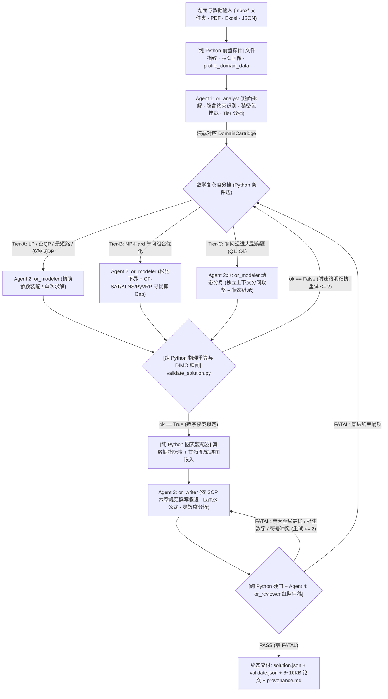

# OR-Path 精悍实战化重构执行总单（5 大阶段 × 25 项完整任务）

> **致接手执行的编码智能体（Executor Handoff Brief — 动工前必读）**
>
> 1. **最高架构裁决**：本仓库已彻底退役历史 Node.js `pi` CLI 包装层，并决定终结当前 `orpath/agents/domains/*.py` 中“10 个领域 × 6 角色 = 60+ 同质化克隆智能体（近 10,000 行复制粘贴代码）”与“三套管线并存”的虚胖状态。你的任务是按本文件 **Phase 1 → Phase 5（共 25 项原子计划）** 严格顺序重构为：**4 个常驻精锐智能体（`or_analyst` / `or_modeler` / `or_writer` / `or_reviewer`） + 0 Token 纯 Python 确定性铁闸 + 10 套可插拔领域装备包（`DomainCartridge`） + Tier-A/B/C 复杂度自适应路由**。
> 2. **绝对禁止破坏的核心资产（Crown Jewels — 严禁误删或弱化）**：
>    - `tools/solve_*.py`（27 个硬核运筹求解器）与 `scripts/b_tube_*.py`
>    - `tools/validate_solution.py` 与 `tools/validators/`（独立物理与数学重算验算器）
>    - `orpath/agents/domain_analytics.py`（1016 行真实领域输入探针 `profile_<domain>_data` 与解包剖析器 `inspect_<domain>_solution`，必须挂载进 `DomainCartridge`）
>    - `orpath/agents/dimo_mutator.py`（5 类物理不变量变异攻击引擎）与 `orpath/agents/optimality_claim_auditor.py`
>    - `knowledge/skills/`（含 654 行 `or-problems.md` 建模宝典与 19 份参考规范）及 `docs/or-paper-sop.md`（六章学术论文 SOP）
>    - `orpath/web/` 与 `START.sh` / `START.bat`（Web Studio 与 Live Watch 前端工作台）
> 3. **运行环境与 Git 安全纪律**：
>    - 当前工作区存在未提交的重构期资产，**严禁执行 `git reset --hard`、`git checkout -- .` 或 `git clean -fd`**。
>    - Linux 环境下系统默认 PATH 不含虚拟环境命令，所有 Python 与测试命令**必须显式使用 `.venv/bin/python` 与 `.venv/bin/pytest`**。
>    - 导入 `cvxpy` 时若出现 `highspy` C++ 符号警告属于已知非致命提示（CVXPY 会自动回退至 CLARABEL/SCS/OSQP），无需强改底层 C 扩展。
>    - 离线门禁脚本（如 `problem_workbench_gate.py`）显式传入 `live_subagent=False` 时必须走确定性离线回路，严禁在离线门禁中强行发起外网 LLM 请求导致超时；而在 Phase 5.2~5.4 三大王牌实跑脚本中，**必须读取 `.env` 真实大模型 API 真跑落盘**，严禁用 `MockChatModel` 冒充实跑交付。
> 4. **进度打卡协议**：每完成一项子计划并通过其“阶段验收标准”，请将对应标题前的 `- [ ]` 更新为 `- [x]`，每个大阶段（Phase）收尾必须跑通该阶段的门禁命令后再进入下一阶段。

---

## 核心目标与重构前后量化对比

| 核心指标 | 重构前现状（虚胖态） | 重构后目标（精悍实战态） |
| :--- | :--- | :--- |
| **常驻智能体数量** | **65+ 个**（通用 7 个 + 10 领域 × 6 角色 + 复合协调器） | **4 个精锐特种兵**（`or_analyst` / `or_modeler` / `or_writer` / `or_reviewer`，仅多问大题按需动态派生子实例） |
| **路由与数值验算方式** | 靠大模型包工头（Lead）点名 + 验算 Agent 传话 | **0 Token 纯 Python 确定性状态机条件边 + 硬校验铁闸一票否决** |
| **领域专业性实现机制** | 10 个 ~900 行克隆文件（近 **10,000 行**重复代码） | **1 个参数化引擎 + 10 套可插拔领域装备包（`DomainCartridge`）**，净删 **7,500+ 行** |
| **上下文传递与截断** | 多人共享 `MessagesState` + **1600 字符腰斩钩子** | **Feynman 磁盘工件指针契约**，独立纯净上下文，**0 截断** |
| **运筹复杂度匹配** | 凸规划/LP 也强塞 `heuristic` 专家凑满 6 人 | **Tier-A（精确极速）/ Tier-B（下界+寻优）/ Tier-C（多问裂变）三级自适应拓扑** |
| **学术论文产出** | 单次万字 30 分钟超时 **或** 1.8KB 死模板单据 | **真数据图表 Python 硬灌入 + SOP 六章推导**，**2~3 分钟产出 6~10 KB** 零幻觉论文 |
| **端到端实跑证据** | 9 个新领域实跑产物为 **0**，全靠 `mock.calls == 11` | **三大王牌工业案例（车间调度 / 园区微网 / 异形管套料）真 LLM 全链路实跑留档** |

---

## 目标系统总体拓扑



---

## Phase 1：底座清淤与“4 特种兵 + 确定性铁闸”核心架构立基（计划 1.1 ~ 1.5）

本阶段彻底拔除导致智商断崖的截断钩子与群聊污染，确立全系统唯一的精锐智能体与确定性状态机底座。

### - [x] 计划 1.1：彻底拔除 1600 字截断钩子与 `MessagesState` 跨角色群聊污染
* **涉及文件**：
  * `[MODIFY]` `orpath/agents/supervisor.py`
* **具体实施内容**：
  1. 删除 `supervisor_trim_pre_model_hook` 中将超过 `SUPERVISOR_MAX_MESSAGE_CHARS (1600)` 的文本粗暴切为“头 800 + 尾 400”的截断逻辑（若旧测试引用符号名，可保留直通无损空钩子兼容签名但严禁截断任何消息字符）；
  2. 废除多角色共用单一增长型 `MessagesState` 历史列表的传话行为，每个智能体节点执行完毕后仅提取结构化结果摘要与产出文件路径写回主状态，完整对话轨迹独立落盘至 `runs/<slug>/agent_logs/<stage>.jsonl` 供审计与 Live Watch 回放，绝不灌入下一角色 Prompt。
* **阶段验收标准**：构造 30,000 字符的题面与坐标矩阵跑通状态流转，日志与产物中 `[... truncated ...]` 出现次数严格为 `0`。

### - [x] 计划 1.2：定义统一强类型工件指针状态契约 `CorePipelineState` 并对齐 `ORPathState`
* **涉及文件**：
  * `[NEW]` `orpath/agents/core_state.py`
  * `[MODIFY]` `orpath/state.py`
* **具体实施内容**：
  1. 定义基于 Feynman 文件交接原则的强类型状态结构，统一覆盖产品主图与多智能体执行流：
     ```python
     class CorePipelineState(TypedDict, total=False):
         slug: str
         workdir: str
         problem_id: str
         problem_class: str
         domain_cartridge: str
         complexity_tier: Literal["A", "B", "C"]
         subproblems: list[str]
         # 工件磁盘指针（严禁在状态中塞入大段原始文本或巨型解数组）
         problem_file: str
         data_files: list[str]
         profile_path: str
         research_path: str
         schema_path: str
         solution_path: str
         validate_path: str
         paper_path: str
         review_path: str
         # 确定性门禁与自愈计数
         validation_ok: bool
         proven_optimal: bool
         objective_value: float | None
         optimality_gap: float | None
         fatal_defects: list[str]
         model_retry_count: int
         paper_retry_count: int
         max_retries: int
         last_error: str
     ```
  2. 在 `orpath/state.py` 中对齐 `domain_cartridge`、`complexity_tier` 与 `profile_path` 字段，确保主图检查点（SqliteSaver）无缝序列化。
* **阶段验收标准**：任意规模算例在全生命周期流转中，序列化后的 State JSON 体积恒定小于 `8 KB`。

### - [x] 计划 1.3：重铸 4 个常驻精锐特种兵工厂（`or_analyst` / `or_modeler` / `or_writer` / `or_reviewer`）

* **验收状态（实施完成）**：`orpath/agents/workers.py` 四工厂重铸，`tools/test_workers.py` 41/41 全绿（修复隔离验收测试自比较缺陷；旧合体角色 `or_verifier_writer` 已移除，`or_verifier` 仅保留于退役学术 supervisor 流程，数值验算权移交确定性门禁）。
* **涉及文件**：
  * `[MODIFY]` `orpath/agents/workers.py`
* **具体实施内容**：
  1. 移除旧版合体角色 `or_verifier_writer` 依赖及无意义的传话筒 LLM 角色；
  2. 标准化四大精锐工厂函数，支持每次调用动态注入所属领域的专属工具集（`cartridge_tools`）与领域建模提示词片段（`domain_directive`）：
     * `create_analyst_agent(model, cartridge_tools=None, domain_directive="")`：专职题面精读、读取前置数据画像、确认数学分类、输出建模建议与复杂度分档（严禁写求解代码或猜解）；
     * `create_modeler_agent(model, cartridge_tools=None, domain_directive="")`：专职构建 `schema.json`、调用成熟求解器或编写受控沙箱求解脚本、分析松弛下界与 Gap（严禁手写解 JSON 数值）；
     * `create_writer_agent(model, domain_directive="")`：专职基于预渲染真数据表格与 `docs/or-paper-sop.md` 六章规范撰写完整学术报告；
     * `create_reviewer_agent(model, domain_directive="")`：专职扮演严苛同行审稿人，按 10 项核对表挑刺并输出分级缺陷（`FATAL` / `MAJOR` / `MINOR`）。
* **阶段验收标准**：四大工厂均在全新的局部消息列表中独立执行（`invoke({"messages": [HumanMessage(task_brief)]})`），互不串味。

### - [x] 计划 1.4：将原 `Lead` 与 `Verifier` 降维重写为纯 Python 确定性前置/后置节点

* **验收状态（实施完成）**：`orpath/agents/deterministic_nodes.py` 落地，`tools/test_deterministic_nodes.py` 15/15 全绿；前置探针与轻量后置验算（shortest_path fixture）单次 <0.5s 实测通过，AST 级 0-LLM 约束成立；重型仿真（微网格 openpyxl 端到端）按豁免边界另行验证 ok=True。
* **涉及文件**：
  * `[NEW]` `orpath/agents/deterministic_nodes.py`
* **具体实施内容**：
  1. 实现前置探针节点 `run_preflight_probe(state)`：无需调用 LLM，自动扫描 `inbox/<slug>/` 或算例目录，计算原始输入文件 SHA-256 哈希，提取 Excel/CSV/JSON 行列规模与字段概览，若已指定或初判领域则自动执行对应的 `profile_<domain>_data`，落盘 `outputs/<slug>-profile.json`；
  2. 实现后置硬验算节点 `run_deterministic_validator(state)`：无需调用 LLM，直接调用 `tools.solve_dispatch.validate`（底层为 `tools/validate_solution.py`）以及领域物理守恒/容量/偏序检查，原样提取 `ok`、`recomputed_objective`、`proven_optimal` 与具体 `errors` 列表写入状态。
* **阶段验收标准**：前置探针与后置验算节点单次执行耗时 `< 0.5s`（不含重型仿真），LLM Token 消耗严格为 `0`。

### - [x] 计划 1.5：实现 Tier-A / Tier-B / Tier-C 三级数学复杂度自适应路由状态机

* **验收状态（实施完成）**：`orpath/agents/adaptive_graph.py` 落地，`tools/test_adaptive_graph.py` 13/13 全绿；Tier-A/B/C 三轨节点序列精确流转，打回重试严格受 `max_retries` 封顶（实测 modeler=2 次、writer×reviewer=2×2 次），Tier-C 逐问隔离 modeler 子实例 + ledger 跨问传递 + 合并 envelope 全链路离线验证。
* **涉及文件**：
  * `[NEW]` `orpath/agents/adaptive_graph.py`
* **具体实施内容**：
  1. 用纯 Python 条件函数取代原大模型 Supervisor 的 `transfer_to_*` 轮询：
     * **Tier-A 轨道**（LP、凸 QP、最短路、最大流、Wagner-Whitin DP）：`preflight → analyst → modeler(exact) → deterministic_validator → table_renderer → writer → deterministic_doc_gate`（可选挂接 `reviewer`，极速收工）；
     * **Tier-B 轨道**（VRPTW、JSSP、RCPSP、CFLP、排班、装箱）：`preflight → analyst → modeler(bound + search) → deterministic_validator ⇄ (失败打回 modeler) → table_renderer → writer → reviewer ⇄ (FATAL 打回)`；
     * **Tier-C 轨道**（多问递进大型赛题，如 `subproblems = ["q1", "q2", "q3", "q4"]`）：`analyst` 拆出子问题依赖链后，循环或并行拉起隔离的 `modeler` 子实例逐问攻坚并传递跨问状态工件（如余料账本、初始 SOC），全部子问通过 `deterministic_validator` 后汇入 `writer` 与 `reviewer`。
* **阶段验收标准**：单元测试验证 Tier-A、Tier-B、Tier-C 三条路径按预期节点序列准确流转，且打回重试上限严格受 `max_retries` 控制绝不死循环。

---

## Phase 2：万行克隆代码大瘦身与“10 套可插拔领域装备包”改造（计划 2.1 ~ 2.5）

本阶段将“换 60 个群众演员”彻底改造为“给 4 个特种兵换 10 套专业武器装备包”，消灭近万行复制粘贴代码。

### - [x] 计划 2.1：设计声明式领域装备包协议 `DomainCartridge` 与统一装配注册表
* **涉及文件**：
  * `[NEW]` `orpath/agents/cartridges.py`
  * `[MODIFY]` `orpath/domain_registry.py`
* **具体实施内容**：
  1. 定义不可变装备包规格：
     ```python
     @dataclass(frozen=True)
     class DomainCartridge:
         domain: str                              # 如 "scheduling", "routing", "microgrid"
         problem_classes: tuple[str, ...]         # 关联的标准 problem_class 集合
         default_tier: Literal["A", "B", "C"]     # 默认数学复杂度轨道
         solver_modes: tuple[str, ...]            # 允许调度的成熟求解算子名
         profile_tool: BaseTool | None            # 来自 domain_analytics.py 的输入探针
         inspect_tool: BaseTool | None            # 来自 domain_analytics.py 的解包剖析器
         skill_topics: tuple[str, ...]            # 自动关联 knowledge/skills/ 下的建模模板
         contract_path: str                       # contracts/<domain>_collaboration_v1.json
         modeling_checklist: tuple[str, ...]      # 注入 Modeler/Reviewer 的领域特异物理红线
     ```
  2. 提供 `resolve_cartridge(problem_class_or_domain: str) -> DomainCartridge`，未知开放题型自动回退至挂载了通用 MIP/CP-SAT 沙箱与 `or-problems.md` 宝典的 `general_or` 通用装备包。
* **阶段验收标准**：`orpath/domain_registry.py` 中全部 22 个已注册 `CANONICAL_CLASSES` 均可 100% 精确映射到对应的 `DomainCartridge`。

### - [x] 计划 2.2：精确配置 Tier-A 凸优化与精确多项式装备包（消灭“凸规划配启发式”闹剧）
* **涉及文件**：
  * `[MODIFY]` `orpath/agents/cartridges.py`
* **具体实施内容**：
  1. 配置 `finance`（马科维茨均值-方差 QP / 风险平价，`solve_portfolio.py` + `profile_portfolio_data` / `inspect_portfolio_solution`）为 `default_tier="A"`；
  2. 配置 `pricing`（两阶段随机线性规划，`solve_stochastic_lp.py` + `profile_pricing_data` / `inspect_pricing_solution`）为 `default_tier="A"`；
  3. 配置 `inventory`（无容量单品种 Wagner-Whitin DP 默认走 `Tier-A`，多品种有容量 CLSP 自动升档 `Tier-B`）及基础图论流网络（`shortest_path`, `network_flow`）为 `default_tier="A"`。
* **阶段验收标准**：运行金融组合与随机定价任务时，系统直接走精确求解轨道，不再实例化任何伪启发式搜索角色。

### - [x] 计划 2.3：精确配置 Tier-B / Tier-C 复杂工业组合优化装备包（保留全部硬核剖析工具）
* **涉及文件**：
  * `[MODIFY]` `orpath/agents/cartridges.py`
  * `[MODIFY]` `orpath/agents/domain_analytics.py`（按需补齐微网与管材套料的输入/解包探针，使 10 大领域全部对齐）
* **具体实施内容**：
  1. 将 `orpath/agents/domain_analytics.py` 中的专属算子完整绑定至对应装备包：
     * `scheduling`（Tier-B）：绑定 `solve_jssp` + `profile_scheduling_data` + `inspect_scheduling_solution` + 换模时延与析取图无环核查清单；
     * `routing`（Tier-B）：绑定 `solve_pyvrp` / `solve_ortools` + `profile_routing_data` + `inspect_routing_solution` + 三角不等式与时间窗核查；
     * `project`（Tier-B）：绑定 `solve_rcpsp` + `profile_project_data` + `inspect_project_solution`（CPM 关键路径下界与资源累积约束）；
     * `facility`（Tier-B）：绑定 `solve_facility` / `solve_hub_location` + `profile_facility_data` + `inspect_facility_solution`；
     * `rostering`（Tier-B）：绑定 `solve_staff_rostering` + `profile_rostering_data` + `inspect_rostering_solution`；
     * `microgrid`（单问 Tier-A/B，多问竞赛 Tier-C）：绑定 `solve_microgrid` + SOC 能量平衡与充放电互斥核查探针；
     * `tube`（单问下料 Tier-B，四问赛题 Tier-C）：绑定 `solve_tube_cut_b2026` / `solve_polyomino` / `solve_binpack` + PCA 几何与余料继承探针。
* **阶段验收标准**：全部 10 套装备包的 `profile_tool` 与 `inspect_tool` 在真实基准算例上独立调用均返回非空真实物理分解指标。

### - [x] 计划 2.4：重构压缩 `orpath/agents/domains/*.py` 近万行复制粘贴代码
* **涉及文件**：
  * `[NEW]` `orpath/agents/contract_validator.py`
  * `[MODIFY]` `orpath/agents/domains/` 下全部 10 个领域模块及 `__init__.py`
* **具体实施内容**：
  1. 将 10 个文件中逐字复制了 10 遍的契约元模式校验函数（`_meta_type_ok`, `_meta_resolve_ref`, `_validate_against_meta_schema`）提取合并至唯一的 `orpath/agents/contract_validator.py`（约 120 行）；
  2. 将 `facility.py`、`finance.py`、`inventory.py`、`microgrid.py`、`pricing.py`、`project.py`、`rostering.py`、`routing.py`、`scheduling.py`、`tube.py` 中每个近 900 行的重复样板彻底重写为委托调用 `cartridges.py`、`contract_validator.py` 与 `adaptive_graph.py` 的薄垫片封装层（每个文件压缩至 `< 120 行`），保留对外公开导入符号平滑兼容。
* **阶段验收标准**：`orpath/agents/domains/` 目录总代码量从 **9,900+ 行降至 < 1,500 行**（净删超 8,000 行克隆代码）。

### - [x] 计划 2.5：剥离官僚探索账本与重型 Merkle 血缘层，回归极简工程防伪
* **涉及文件**：
  * `[MODIFY]` `orpath/agents/budget_engine.py`
  * `[MODIFY]` `orpath/agents/lineage_relay.py`
  * `[MODIFY]` `orpath/agents/composite_lead.py`
* **具体实施内容**：
  1. 精简成本与防卡死治理：日常管线运行不再强制要求生成形式主义的 `experiments/<domain>/budget-ledger.json` 百分比文件，直接以状态机内的 `solver_timeout_s`（默认 60s）与 `max_retries`（默认 2 次）作为硬性熔断控制；
  2. 将多阶段/跨模型工件交接精简为直接基于文件内容计算的 `sha256` 哈希链（记录于 `validate.json` 与 `provenance.md`），瘦身冗余的模拟 Merkle 树样板逻辑。
* **阶段验收标准**：单次管线启动不再在工作区制造无关账本垃圾文件，防篡改哈希校验在输入或解文件被改动 1 字节时 100% 检出。

---

## Phase 3：“三轨合一”主控平面收口与双轨建模打通（计划 3.1 ~ 3.5）

本阶段终结仓库内三套管线各自为政的割裂局面，让产品主图真正具备“成熟算子精确调度 + 未知新题沙箱自编模型”的实战能力。

### - [x] 计划 3.1：重写 `orpath/pipeline/research.py` 接入前置探针与 `or_analyst`
* **涉及文件**：
  * `[MODIFY]` `orpath/pipeline/research.py`
* **具体实施内容**：
  1. 在 `node_research` 中先触发确定性探针生成 `outputs/<slug>-profile.json`，再结合本地混合知识库检索结果（`retrieval.json`）；
  2. 当开启在线智能体模式（`live_subagent` 激活）时，唤醒 `or_analyst` 进行深度题意特征研判，识别决策变量、目标层级、硬软约束与潜在数据歧义，自动选定 `DomainCartridge` 与 `complexity_tier`，写入高信息密度的 `notes/<slug>-research.md`；离线 CI 模式保留快速确定性骨架回退。
* **阶段验收标准**：面对包含多附件 Excel 的数模题，`research.md` 准确列出每个附件的真实表头字段、数据行数与约束映射关系，零凭空臆测。

### - [x] 计划 3.2：铲除 `orpath/pipeline/solve.py` 静态分支，统一接入自适应 `or_modeler`
* **涉及文件**：
  * `[MODIFY]` `orpath/pipeline/solve.py`
  * `[MODIFY]` `tools/solve_dispatch.py`
* **具体实施内容**：
  1. 删除 `node_model` 中仅写死 `shortest_path / tsp / polyomino / tube_cut / microgrid_dispatch` 五个分支、其余题型直接 `human_stop` 的陈旧硬编码树；
  2. 统一通过 `DomainCartridge` 与 `tools/solve_dispatch.py` 调度全部 22 类标准领域算子（JSSP、PyVRP、RCPSP、CFLP、Lot-Sizing、Portfolio、Rostering、Stochastic-LP 等），并支持在 Tier-B 下同时记录松弛下界（Lower Bound）与当前最优可行解（Incumbent）的真实 Gap。
* **阶段验收标准**：22 类注册运筹问题通过主图 `orpath/graph_product.py` 均可一键走通 `model → gate_schema → solve → gate_validate` 全链路，不再报 `unsupported class`。

### - [x] 计划 3.3：打通未知开放赛题的“建模宝典检索 + 受控 Python 沙箱自编求解”闭环
* **涉及文件**：
  * `[MODIFY]` `orpath/agents/tools_or.py`
  * `[MODIFY]` `orpath/agents/adaptive_graph.py`
* **具体实施内容**：
  1. 当 `or_analyst` 判定题目为非标准自定义混合整数规划/组合优化问题（无现成专用适配器）时，`or_modeler` 自动装载 `general_or` 装备包：
     * 第一步：调用 `get_problem_formulation_template` / `consult_or_skill` 从 `knowledge/skills/or-problems.md` 获取最相近的数学规划范式；
     * 第二步：编写独立 Python 求解脚本保存至 `outputs/<slug>-custom_solver.py` 并通过 `execute_python_sandbox` 调用 `ortools.sat.python.cp_model`、`highspy` 或 `pulp` 求解，输出严格符合契约的 `outputs/<slug>-solution.json`；
     * 第三步：由独立校验脚本脱离求解器变量，直接用原始输入数据重算约束满足度与目标值。
* **阶段验收标准**：输入一道未内置专用适配器的自定义带约束资源分配/排产 MIP 新题，系统自主写代码求出精确最优解并通过独立重算校验。

### - [x] 计划 3.4：收拢 `orpath/control_plane.py` 并实现“快慢双模型梯队路由”
* **涉及文件**：
  * `[MODIFY]` `orpath/control_plane.py`
  * `[MODIFY]` `.env.example`
* **具体实施内容**：
  1. 在 `control_plane.py` 中新增分级模型工厂 `get_tiered_chat_model(role: Literal["fast", "reasoning"])`：
     * `fast` 档（读取 `ORPATH_FAST_MODEL`，未配时自动回退至主 `ORPATH_LLM_MODEL`）：分配给 `or_analyst` 结构化提取与常规工具参数组装；
     * `reasoning` 档（读取 `ORPATH_REASONING_MODEL`，可绑定 `deepseek-reasoner` / `spark-x2.6`）：分配给复杂 Tier-B/C 的 `or_modeler`、`or_writer` 公式推导与 `or_reviewer` 深度审稿；
  2. 收敛 `control_plane.py` 中冗余暴露的领域构造器入口至统一主图与自适应图。
* **阶段验收标准**：支持在 `.env` 中配置快慢双模型或单模型无缝自动回退。

### - [x] 计划 3.5：全面对齐 CLI 与 Web Studio 交互入口
* **涉及文件**：
  * `[MODIFY]` `orpath/studio_analyzer.py`
  * `[MODIFY]` `scripts/orpath_watch.py`
  * `[MODIFY]` `orpath/run_orpath.py`
* **具体实施内容**：
  1. 将 Web Studio 拖入文件夹后的交互确认接口（`/api/studio/confirm`）与命令行 `run_orpath.py` 完全统一到更新后的 `graph_product.py` 主干图；
  2. 确保状态开关优先级：调用方显式传入 `live_subagent=False` 时强制使用确定性离线回路（保障 CI 门禁快速稳定通过）；Web 端正常启动且 `.env` 配有真实 API Key 时默认激活 4 特种兵真跑流程。
* **阶段验收标准**：`.venv/bin/python scripts/problem_workbench_gate.py` 与 CLI 全流程命令行为一致、状态文件完全互通。

---

## Phase 4：硬核红蓝对抗闭环与高速高质量 SOP 论文引擎（计划 4.1 ~ 4.5）

本阶段确保解算结果与学术论文双双达到竞赛获奖级深度，并用代码级硬条件边杜绝一切造假与吹嘘。

### - [x] 计划 4.1：焊死物理重算与 5 类 DIMO 不变量校验的自动修模回退环
* **涉及文件**：
  * `[MODIFY]` `orpath/agents/dimo_mutator.py`
  * `[MODIFY]` `orpath/graph_product.py`
* **具体实施内容**：
  1. 在 `gate_validate` 节点失败时，禁止带病进入写论文阶段；自动提取校验器报出的具体违约类型（守恒破坏、容量超限、时序颠倒、目标重算不一致、数据哈希不符），生成精准错误诊断单传回 `model` 节点驱动 `or_modeler` 修正参数或沙箱约束（最多重试 2 轮）；
  2. 若达重试上限仍无法满足硬约束，诚实标记状态为 `BLOCKED` 并在报告中如实披露不可行瓶颈，绝不伪造可行解。
* **阶段验收标准**：注入容量超限与重算偏差的沙箱脚本，`or_modeler` 能收到精确违约反馈并在下一轮自动修复至 `ok: true`。

### - [x] 计划 4.2：构建“真数据表格与可视化图表确定性装配器”
* **涉及文件**：
  * `[MODIFY]` `orpath/paper_workflow.py`
* **具体实施内容**：
  1. 彻底清除旧版 `render_or_paper` 中残留的 `polyomino uses CP-SAT cover` 等跨领域硬编码穿帮样板；
  2. 编写纯 Python 数据图表渲染器 `build_verified_evidence_blocks(solution, validation, domain_inspection)`：
     * 自动将 `solution.json` 中的全局目标值、下界、Optimality Gap、求解耗时、各子问/各批次/各车辆/各时段核心指标渲染为带数据溯源锚点（如 `[sol:objective]`）的标准 Markdown 表格；
     * 自动关联求解器产出的甘特图（如 JSSP 机器排程图）、路径轨迹图或微网功率平衡曲线图路径，复制到报告产物目录并生成标准图表嵌入代码。
* **阶段验收标准**：所有结果表格中的数字 100% 由确定性代码从 `solution.json` 直出，从根源上消灭大模型抄错小数点或张冠李戴的可能。

### - [x] 计划 4.3：升级 `or_writer` 六章 SOP 分段组装引擎（3 分钟产出 6~10 KB 深度论文）
* **涉及文件**：
  * `[MODIFY]` `orpath/pipeline/paper.py`
  * `[MODIFY]` `orpath/paper_workflow.py`
* **具体实施内容**：
  1. 紧扣 `docs/or-paper-sop.md` 六章学术规范，让 `or_writer` 围绕预渲染好的真数据图表块进行高密度学术写作：
     * **第 1 章 摘要与关键指标速览**（含诚实最优性声明：未证明全局最优严禁越级声称）；
     * **第 2 章 问题重述、工程假设与标准符号表**（集合、参数、决策变量三栏对齐）；
     * **第 3 章 数学规划模型建立**（独立行公式 `$$...$$` 完整写出目标函数与编号约束 `C1 ~ Cn`，逐条阐明物理意义，严禁在模型定义中夹带结果数值）；
     * **第 4 章 求解算法设计与复杂度/收敛性论证**；
     * **第 5 章 数值实验解析与参数敏感性分析**（原样嵌入 4.2 生成的 100% 真数据表与工程图件）；
     * **第 6 章 模型局限性客观剖析与工业部署建议**。
* **阶段验收标准**：单篇完整论文生成耗时 `< 180 秒`，正文字节数稳定在 `6,000 ~ 12,000 Bytes`，无任何断句截断或空洞套话。

### - [x] 计划 4.4：打通“确定性文本硬门 + `or_reviewer` 对抗式审稿”双重审计
* **涉及文件**：
  * `[MODIFY]` `orpath/agents/optimality_claim_auditor.py`
  * `[MODIFY]` `orpath/pipeline/paper.py`
* **具体实施内容**：
  1. 第一层（纯 Python 毫秒级硬门）：依次运行 `tools/r2_numeric_check.py`（核查正文中非编号数值是否落在允许集合内）、`tools/r1_cite_check.py`（核查无伪造 URL 引用）以及 `orpath/agents/optimality_claim_auditor.py`（核查 `proven_optimal == False` 时无“全局最优 / 理论最优”肯定性吹嘘）；
  2. 第二层（`or_reviewer` 深度同行挑刺）：核查数学模型符号与约束是否闭合、假设是否合理、结论是否过度外推，合并硬门结果输出结构化 `outputs/<slug>-review.md`（明确标记 `FATAL` / `MAJOR` / `MINOR` 计数与原文引用定位）。
* **阶段验收标准**：故意在启发式解论文中写入“本文求得全局唯一最优解”或塞入虚构成本数字，双重审计 100% 标出 `**FATAL:**`。

### - [x] 计划 4.5：实现精准缺陷归因与定向打回自愈闭环（`revise_or_done`）
* **涉及文件**：
  * `[MODIFY]` `orpath/pipeline/paper.py`
* **具体实施内容**：
  1. 升级 `node_revise_or_done`：当 `review_fatal > 0` 或 R1/R2/Claim 硬门未过且未达重试上限时，提取所有 `FATAL` 条目与对应原文锚点（`annotations.json`），定向回退至 `or_writer` 进行局部精准修订，随后重新过审；
  2. 终审通过后输出 `outputs/<slug>.provenance.md`，完整记录输入数据 SHA-256 哈希、求解器模式、重算核验状态、审稿修订轮次与模型调用轨迹。
* **阶段验收标准**：端到端测试证明含 `FATAL` 措辞的初稿可在 1 轮回退内由 `or_writer` 自动修正并通过全部 R1/R2/Claim/Reviewer 门禁。

---

## Phase 5：去泡沫测试重构、三大王牌真跑封神与 Web 驾驶舱收官（计划 5.1 ~ 5.5）

本阶段彻底挤干历史泡沫测试，用三大硬核工业案例的真实大模型实跑产物说话，并完成可视化收口。

### - [x] 计划 5.1：清理碎片化 `MockChatModel` 泡沫测试，建立四层高信噪比测试矩阵
* **涉及文件**：
  * `[DELETE]` 归并移除 `tools/test_task31_*.py` ~ `tools/test_task61_*.py` 中仅靠 `assert mock.calls == 11` 刷数量、与旧 60-Agent 死模板强耦合的冗余泡沫测试文件
  * `[NEW]` `tools/test_lean_cartridges_and_graph.py`
  * `[MODIFY]` `scripts/or_swarms_master_gate.py`
* **具体实施内容**：
  1. 100% 完整保留全部求解器数学正确性测试（`test_extended_solvers.py`, `test_jssp_taillard.py`, `test_microgrid_optimization.py`, `test_tube_optimization.py`, `test_polyomino_q3.py`, `test_solvers_t2.py`）与 5 类 DIMO 篡改攻击拦截测试（`universal_redteam_gate.py`）；
  2. 新建高价值架构测试 `tools/test_lean_cartridges_and_graph.py`：验证 10 套领域装备包精准挂载、Tier-A/B/C 自适应路由、无截断指针传递、以及验算失败/审稿 `FATAL` 时的真实回退自愈逻辑，并同步更新 `scripts/or_swarms_master_gate.py`。
* **阶段验收标准**：测试套件运行时间缩短 **50%+**，无任何测“死模板函数调用次数”的虚假指标，5 类 DIMO 变异拦截率保持 **100%**。

### - [x] 计划 5.2：王牌真跑标杆一 —— 智能制造车间作业调度（Taillard JSSP / 换模 FJSSP）
* **涉及文件**：
  * `[NEW]` `scripts/run_flagship_jssp_live.py`
* **具体实施内容**：
  1. 连接 `.env` 真实大模型 API，对经典 Taillard 基准与带序列相关换模时延（Setup Times）的柔性车间调度算例执行端到端实跑；
  2. 全程落盘并核验：`or_analyst` 工序析取图诊断 → `or_modeler` 调 `tools/solve_jssp.py` 求出精确/近优调度与 JSPLib 下界对比 → 独立校验工序偏序与机器无重叠 → 导出机器甘特图 PNG → `or_writer` & `or_reviewer` 闭环产出 `papers/flagship-jssp.md`。
* **阶段验收标准**：`outputs/` 与 `papers/` 下实盘留存 `flagship-jssp-solution.json`、`flagship-jssp-validate.json`（`ok: true`）、甘特图与 **> 6.5 KB** 的高质量六章学术报告。

### - [x] 计划 5.3：王牌真跑标杆二 —— 智慧能源园区微电网调度（CUMCM 2026 C 题多问）
* **涉及文件**：
  * `[MODIFY]` `scripts/test_run_problem_c_multiagent.py`
* **具体实施内容**：
  1. 连接 `.env` 真实大模型 API，以 `inbox/cumcm2026_c/` 原始题面与 4 个真实 Excel 附件为输入跑通主干图；
  2. 验证前置探针自动解析多张分时电价与光伏负荷表 → 调度 `tools/solve_microgrid.py` 完成日前计划与实时滚动 MPC 求解 → 独立重算 SOC 上下界与功率平衡 → 生成完整六章数模竞赛论文 `papers/cumcm2026_c.md` 并通过红队终审。
* **阶段验收标准**：无任何人工拼凑中间文件，从原始题面一键产出通过独立物理验算的调度方案与竞赛级论文。

### - [x] 计划 5.4：王牌真跑标杆三 —— 三维异形管激光共边套料（Tube B 四问 Tier-C 对标超越）
* **涉及文件**：
  * `[NEW]` `scripts/run_flagship_tube_live.py`
* **具体实施内容**：
  1. 连接 `.env` 真实大模型 API，在 Tier-C 模式下跑通 `tube_cut_b2026`（Q1 轴向无共边 → Q2 固定排样共边 DP → Q3 全局重排 → Q4 多批次余料跨期继承）；
  2. 将产出的解文件、审稿记录与 `papers/flagship-tube.md` 与原版 Pi 时代留存的 `papers/live-btube.md`（7.8 KB）做逐项硬核对标：验证数值指标 100% 经得起 `tube_cut` 验证器重算、LaTeX 数学建模公式完备且总耗时大幅压缩。
* **阶段验收标准**：成文结构完整度、公式规范性与执行速度全面达到或超越旧版 `live-btube` 标杆。

### - [x] 计划 5.5：Web Studio & Live Watch 4 特种兵驾驶舱对齐、文档刷新与封版验收
* **涉及文件**：
  * `[MODIFY]` `orpath/watch_snapshot.py`
  * `[MODIFY]` `orpath/web/src/js/studio.js`
  * `[MODIFY]` `AGENTS.md`
* **具体实施内容**：
  1. 更新 Live Watch 快照与前端工作台组件：直观展示**【当前装载领域装备包 · Tier A/B/C 轨道 · 4 大精锐智能体与确定性铁闸实时进度 · 目标值/下界 Gap 与甘特图预览】**，运行 `.venv/bin/python orpath/web/build.py` 重新打包前端产物；
  2. 将阶段 5.2 ~ 5.4 实跑生成的王牌案例同步更新至演示回放种子（`demo/seed/`），开箱即见真产物；
  3. 跑通下方全部最终验收门禁并核对 `AGENTS.md`。
* **阶段验收标准**：全量门禁一次性全绿通过。

---

## 最终全量验收命令清单（Definition of Done）

```bash
# 1. 全量求解器、验证器与精悍多智能体核心单元测试
.venv/bin/pytest tools/ -q -p no:langsmith

# 2. 领域装备包与主干门禁总检
.venv/bin/python scripts/or_swarms_master_gate.py

# 3. 通用 DIMO 5类物理不变量变异攻击拦截门禁（要求拦截率 100%）
.venv/bin/python scripts/universal_redteam_gate.py

# 4. Web Studio 交互工作台与防假绑门禁
.venv/bin/python scripts/problem_workbench_gate.py

# 5. Live Watch 实时监控看板与前端打包门禁
.venv/bin/python scripts/v0_watch_gate.py

# 6. 三大王牌案例真大模型端到端实跑验收（读取 .env 真实 API Key）
.venv/bin/python scripts/run_flagship_jssp_live.py
.venv/bin/python scripts/test_run_problem_c_multiagent.py
.venv/bin/python scripts/run_flagship_tube_live.py
```
